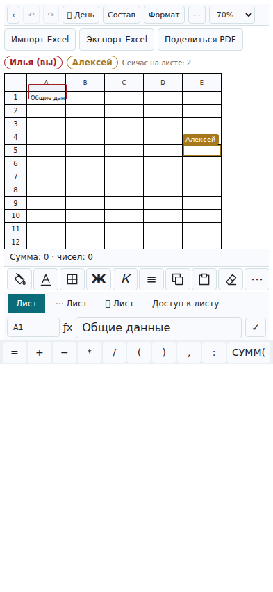
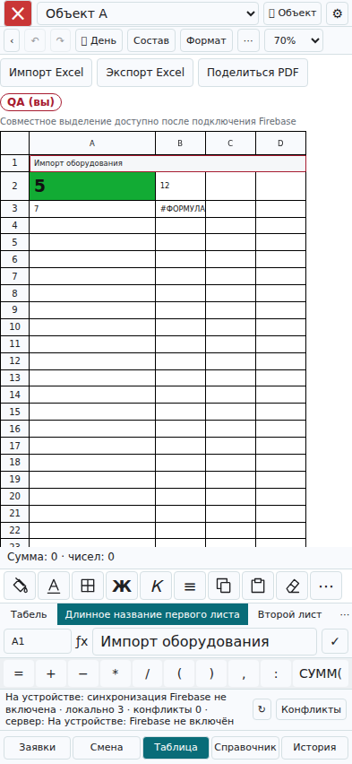

# Таблица 3.4.51 — подготовленный выпуск

Исходная версия: 3.4.50, commit b1328c0c291c115a4a73cb93226c0928780d30c8. Резервная копия исходников: локальный git tag backup-before-table-3451-b1328c0 и удалённая ветка backup/before-table-3451-b1328c0. Действующие правила samosval-offline прочитаны через Firebase Console и сверены с сохранённым исходником; копия firestore-test-before.rules (32845 символов, FNV-1a 900565044). Подготовленные правила firestore-test.rules отличаются добавлением одного изолированного match и исключением новой коллекции из двух общих wildcard-правил. Права существующих данных не меняются.

Реализовано: импорт .xlsx в новые листы, экспорт всей импортированной книги с формулами между листами и сохранением исходных стилей, многостраничный PDF с системным меню отправки, присутствие пользователей и точные диапазоны с одинаковым цветом рамок и имён. Формулы сохраняются, но вычислитель приложения поддерживает арифметику и SUM; сложные функции требуют Excel. В файлах импорта не поддерживаются диаграммы, макросы и условное форматирование.

Проверки:

- 48 unit/domain тестов: node --test tests/tabel-v2/*.test.mjs.
- file-transfer-browser.cjs: настоящий мобильный Chromium 393×852, выбор .xlsx, два листа, формулы и межлистовая ссылка, объединения/цвет, строка 90, скачивание .xlsx и четырёхстраничного PDF, повторное открытие.
- presence-browser.cjs: две изолированные сессии Chromium с настоящим Firestore SDK и эмулятором; список людей, точный B2:D4, соответствие цвета имени и ячеек, смена диапазона, выход; один пользователь смотрит весь объект, другой отдельную неделю — отмечается одна и та же дата/техника.
- presence-rules.cjs: прочитанный live baseline + точечное изменение; разрешены свои записи и чтение доступного листа; запрещены подмена UID, чужие листы, отключённые пользователи, широкие запросы, лишние поля и время из будущего.
- Регрессии: release-3447-browser.cjs, contractor-browser.cjs, simple-keypad-browser.cjs, grid-3442-browser.cjs, shift-scroll-browser.cjs (тестовые и рабочие модули), touch-scroll-browser.cjs, line-motion-3425.cjs, line-motion-3426.cjs.
- Синтаксис модулей, git diff --check, все 80 хешей тестового precache; ExcelJS включён в офлайн-кеш. Рабочая сборка 3.4.50 воспроизводится побайтно: python3 tools/build-release.py --check.

Старый full-browser.cjs остановился на существующем ожидании открытия вкладки «Заявка» (строка 36). Текущая entry/workspace открывает «Смена»; эти исходники в данном изменении не правились. Исторический тест не исправлялся в рамках этой задачи. Актуальные тесты редактора и карточек проходят. Реальное устройство Android, системное меню отправки Android и две живые пользовательские учётные записи Firebase не проверялись.

Публикация правил разрешена пользователем 29.10.2026. В тестовом Firebase samosval-offline опубликована ревизия Today • 6:33 AM (29.10.2026, Москва). После перезагрузки консоли весь опубликованный текст точно совпал с firestore-test.rules: 35571 символ, FNV-1a 2287617430. Правила рабочей базы не изменялись. Код тестовой сборки выпускается через PR #31 после этой сверки. Production index.html, sw.js и app/ не изменялись.

Откат: вернуть предыдущую ревизию правил из firestore-test-before.rules и предыдущий код по тегу; существующие часы/листы/очереди не очищать.

